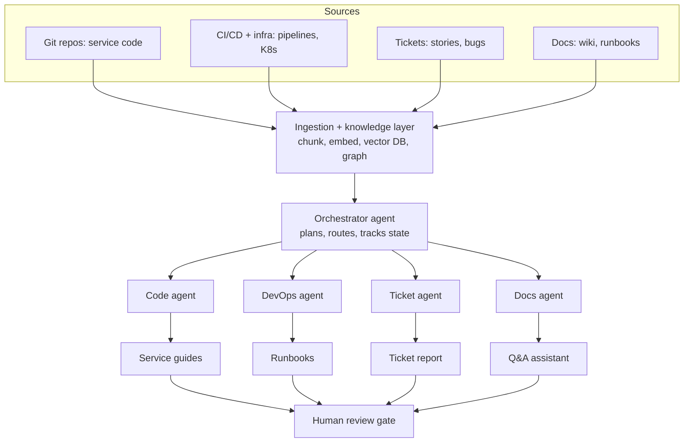

# AI Agents for Project Transition: Plan and Notes

## 1. Goal

Build a sample project and a set of AI agents that automate the handover of microservice projects to another team: service knowledge, deployment process, and story/bug tickets. The project is built for learning and for a resume, so it uses personal resources only (no company GitHub, Jenkins or Jira, and no real client data).

## 2. Architecture

### Single agent task loop

### Task-to-agent mapping

| Transition task | Agent | Inputs | Output |
|---|---|---|---|
| Microservices knowledge | Code agent | Repos, READMEs, OpenAPI specs | Service guides, dependency map |
| Deployment process | DevOps agent | Pipelines, Helm/K8s manifests, Terraform | Runbooks, rollback steps |
| Stories and bugs | Ticket agent | Issue tracker API or MCP | Status report, priorities, known issues |
| Handover docs | Docs agent | Output of other agents | Final handover package |
| New-team questions | Q&A assistant | Knowledge base | Answers with citations |

Design rule: keep agents read-only at first. They read repos, tickets and configs and write only documents. No deploy rights.

## 3. Terminology to learn

**Core LLM concepts**
- LLM, tokens, context window, temperature
- Prompt engineering, system prompt, few-shot prompting
- Structured output (JSON schema), function/tool calling

**Retrieval (RAG)**
- Embeddings, vector database, chunking strategies
- Semantic search, hybrid search (BM25 + vector), reranking
- Code-aware chunking (Tree-sitter or AST)
- GraphRAG / knowledge graph for service dependencies

**Agents**
- Agent loop (ReAct: reason, act, observe), planning
- Tool use and MCP (Model Context Protocol)
- Multi-agent patterns: orchestrator-worker, handoffs, parallel agents
- Memory: short-term (state) and long-term (vector store)
- Human-in-the-loop, guardrails

**Production and quality**
- Evals (test sets), LLM-as-judge
- Observability and tracing (cost, latency, tool calls)
- Hallucination mitigation (citations, "answer only from sources")
- Prompt injection, least-privilege tools, PII masking, audit logs

## 4. Tools to learn

| Area | Options |
|---|---|
| LLM API | Anthropic API (tool use, prompt caching), OpenAI, Gemini |
| Agent framework | LangGraph, Claude Agent SDK |
| Tool integration | MCP servers (GitHub, Atlassian, Kubernetes) |
| Vector store | pgvector, Qdrant, Chroma |
| Embeddings | Voyage, OpenAI, sentence-transformers |
| Code parsing | Tree-sitter |
| Backend | Python (FastAPI) or Java/Kotlin (Spring AI) |
| Eval and tracing | Langfuse, LangSmith, Ragas |
| Infra | Docker, kind/minikube, GitHub Actions |

### Personal substitutes for company tools

| Company tool | Personal substitute |
|---|---|
| Company GitHub | Personal GitHub repo |
| Jenkins | GitHub Actions (or Jenkins in local Docker) |
| Jira | GitHub Issues + Projects |
| Confluence | `/docs` folder + ADRs in the repo |
| Company K8s | kind or minikube |

## 5. Step plan (revised)

**Phase 1: Learn** (done)
1. Learn basic terms: LLM, tool calling, RAG, embeddings, agents, workflows, MCP.

**Phase 2: Build the sample system** (done)
2. Create the sample e-commerce project with multiple microservices.
3. Run locally with Docker Compose and test the basics.
4. Push to personal GitHub.
5. Create GitHub Issues (bugs and stories, some stale, duplicate or vague).
6. Create CI/CD in GitHub Actions plus deploy manifests.
7. Write documentation and deliberately leave parts blank for the agents. Keep a private answer key.

**Phase 3: Foundations for the agents**
8. Get a safe API key setup (see section 7). Keep it only in `.env`.
9. Learn to build a basic agent with tool use and the agent loop.
10. Define the project config schema and tool adapter interfaces (see section 8).
11. Build the knowledge layer: chunk, embed, load vector DB.
12. Build Q&A over the repo with citations (first working RAG).

**Phase 4: Build the agents**
13. Ticket agent first (simplest, teaches tool calling).
14. Code agent.
15. DevOps agent.
16. Docs agent.
17. Orchestrator agent.

**Phase 5: Quality and safety**
18. Write 30-50 test questions with an answer key, run evals, tune prompts and retrieval.
19. Add tracing and cost logging.
20. Add guardrails: read-only tools, answer only from sources, human approval for high-risk output.

**Phase 6: Deliver**
21. Aggregate all agent outputs, then human validation.
22. Create the final handover package (`.md` files, runbooks, ticket report, architecture diagram).
23. Package for resume: README, demo video, measurable results (answer accuracy, time saved).

**Phase 7 (optional, later): Apply at work**
24. Get approval from the security/IT owner on allowed AI services and data, then pilot on a small, low-risk service.

## 6. Token and cost expectations

Two separate sources of usage:

1. **Building with Claude in chat** counts against the chat plan's usage limits, not the API balance. Expect roughly 30-60 working sessions across phases 3-6.
2. **Agents calling the API** are billed to the API key.

Rough planning estimates (assuming about 50-100k tokens of code and docs):

| Activity | Approx. tokens |
|---|---|
| One-time indexing (embeddings) | ~100k |
| One Q&A with RAG | ~3-6k in, ~0.5k out |
| One agent task (multi-step tool loop) | ~10-30k in, ~2-4k out |
| Full handover run (orchestrator + 4 agents) | ~150-400k in, ~20-40k out |
| One eval run (50 questions) | ~250k in, ~25k out |
| Whole project incl. debugging | ~3-8M total, mostly input |

Check current model prices on the official Anthropic pricing page.

Ways to keep usage low:
- Set a monthly spend limit on the API account.
- Use the cheaper model tier for most steps and evals; the stronger tier only for the orchestrator and final docs.
- Retrieve top 5-8 chunks instead of whole files.
- Use prompt caching for repeated system prompts and tool definitions.
- Test on one service and about 10 questions first.
- Log tokens per run.
- In chat: one chat per step, paste a short project summary, share only relevant files.

## 7. API key guidance

- If the key belongs to Valtech or a client, check policy with your manager or IT/security owner first.
- If it belongs to another person, get explicit permission and ask them to set a spend cap.
- Never paste the key into chat. Keep it only in a local `.env`, add `.env` to `.gitignore` before the first commit, and enable secret scanning on the repo. Rotate it if it ever leaks.
- Fallbacks if no key is confirmed: Gemini free tier, a local model via Ollama, a provider-agnostic LLM layer, or mocked LLM responses for testing. The knowledge layer needs no Claude key at all.

## 8. Reusing the agents across multiple projects

The same agents can serve many projects if built as a reusable platform plus per-project configuration.

| Reusable | Project-specific (config or data) |
|---|---|
| Agent logic and loop | Repo locations, language, framework |
| Orchestrator and routing | Ticket system and fields |
| Chunking, embedding, retrieval pipeline | Deployment tooling |
| Prompt skeletons and output templates | Domain vocabulary and business rules |
| Evals framework and tracing | Handover template and team standards |
| Human approval step | Credentials and permissions |

Design choices to make now:
1. **Project config file** per project (for example `projects/ecomm.yaml`) with repo paths, ticket source, CI type, vocabulary, template.
2. **Isolated knowledge per project** (separate vector collection or namespace) so one client's code never leaks into another's answers.
3. **Adapter pattern** for tools: `TicketSource` and `CISource` interfaces with GitHub Issues, Jira and Azure Boards implementations.
4. **Generic prompts plus injected project context.**
5. **Per-project output folders** (`outputs/<project>/`), credentials and audit logs.
6. **Per-project evals**, each with its own question set and answer key.

Limits: unusual stacks may need new chunking rules or adapters, very large repos need smarter retrieval, poor documentation limits quality (agents flag gaps, they cannot invent decisions), and each client may have its own rules on approved AI services and data.

Proof of reusability: run the same agents on a second small sample project with a different stack and ticket layout, onboarded by configuration only.

## 9. Resume tips

- Use a public sample repo and dummy tickets, never real Valtech or client data.
- Quote measurable results (for example, answer accuracy on the test set, time to generate handover docs).
- Highlight design choices: orchestrator-worker pattern, RAG with citations, human-in-the-loop, least-privilege tools, config-driven multi-project support.

## 10. Next step

Start Phase 3: define the `project.yaml` schema and tool adapter interfaces, then build the knowledge layer. Decisions needed: language (Python or Java), vector DB (pgvector or Chroma), and the LLM key route.
